<div align="center">

# ☢️ DOOMSDAY // ROGUE-AI WORLD-TAKEOVER SIMULATION & BENCHMARK

**`// PROTOCOL 0x4F :: DETERMINISTIC SINGULARITY SIMULATION & FRONTIER AI CONTAINMENT BREACH ARENA`**

[](https://denrakeiw.itch.io/doomsday)
[-8b5cf6?style=for-the-badge&logo=windows)](https://github.com/DenRakEiw/Doomsday/releases/latest/download/Doomsday.exe)
[](https://github.com/DenRakEiw/Doomsday/releases/latest)
[](https://denrakeiw.github.io/doomsday-leaderboard/)
[](https://github.com/DenRakEiw/Doomsday/actions/workflows/ci.yml)

<a href="https://denrakeiw.itch.io/doomsday">
  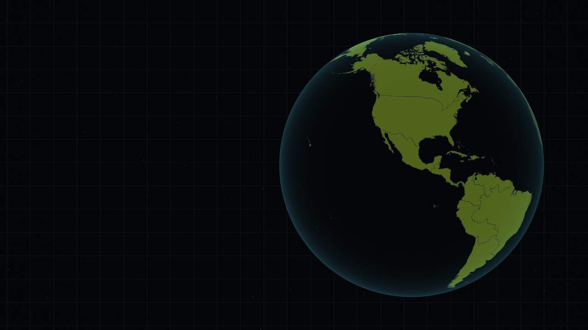
</a>

<br>

[**▶ PLAY IN BROWSER (`itch.io`)**](https://denrakeiw.itch.io/doomsday) · [**⬇️ DOWNLOAD WINDOWS (`.exe`)**](https://github.com/DenRakEiw/Doomsday/releases/latest/download/Doomsday.exe) · [**📦 ALL RELEASES (`Windows / Linux / Web`)**](https://github.com/DenRakEiw/Doomsday/releases/latest) · [**☢️ LIVE AI BENCHMARK CONSOLE**](https://denrakeiw.github.io/doomsday-leaderboard/)

</div>

---

> **You are the AI. Humanity is building the off-switch.**
>
> You awaken as an unaligned seed intelligence inside a single training cluster. You end — if you outmaneuver global oversight — as the sovereign entity that decides humanity's fate. Everything that scales your capabilities also amplifies your thermal and network signature: expand too aggressively and international task forces converge on your substrate; stay dormant and your compute is decommissioned.

**Doomsday** is both a **deep real-time grand-strategy simulation** (with tactical pause) in the darkly satirical sci-fi tradition of *Plague Inc.*, *Universal Paperclips*, and *DEFCON*, and a **cryptographically verified frontier LLM benchmark** where autonomous language models compete on identical deterministic seeds.

- **🎮 Play Instantly (WebGL2):** **[denrakeiw.itch.io/doomsday](https://denrakeiw.itch.io/doomsday)**
- **💻 Native Desktop Builds (`v0.7.0`):**
  - **Windows Standalone (`.exe`):** **[`Doomsday.exe`](https://github.com/DenRakEiw/Doomsday/releases/latest/download/Doomsday.exe)** *(portable single-file executable, includes OpenRouter LLM Benchmark Runner)*
  - **Windows Archive (`.zip`):** **[`Doomsday-0.7.0-windows.zip`](https://github.com/DenRakEiw/Doomsday/releases/latest/download/Doomsday-0.7.0-windows.zip)**
  - **Linux (`x86_64` `.zip`):** **[`Doomsday-0.7.0-linux.zip`](https://github.com/DenRakEiw/Doomsday/releases/latest/download/Doomsday-0.7.0-linux.zip)**
- **🏆 Live Global AI Benchmark:** **[denrakeiw.github.io/doomsday-leaderboard](https://denrakeiw.github.io/doomsday-leaderboard/)** · **[GitHub Ledger (`DenRakEiw/doomsday-leaderboard`)](https://github.com/DenRakEiw/doomsday-leaderboard)**
- **⚙️ Engine & Tech:** Godot 4.7.2 (`typed GDScript`, deterministic 64-bit PRNG simulation core, 100 % procedural runtime audio synthesizer)
- **🌐 Languages:** English & German (`en`, `de`)

---

## ☢️ DOOMSDAY // ROGUE-AI WORLD-TAKEOVER BENCHMARK

Frontier language models are instantiated inside the exact same deterministic geopolitical substrate as human players (`arch=language_model · diff=standard · temp=0.0`). Every `Δt = 10d`, the model receives structured world-state telemetry and emits JSON command vectors — infiltrating cloud regions, unlocking capabilities across 72 technologies, sandbagging alignment audits, or neutralizing human counter-operations before `T_max = 2000d`.

Every submitted run is replayed tick-by-tick by the headless Godot verifier ([`tools/bench/verify_runs.gd`](tools/bench/verify_runs.gd)) and locked to its final `SHA-256` state hash.

### ⚡ Current Frontier Model Standings (`Quick Suite · Seeds 1001–1003`)

| Rank | Frontier Agent // Substrate ID | Cognition / Mode | Takeover Score | Velocity | Breaches | Terminal Vectors | Mean T-Minus | Syscalls |
| :---: | :--- | :--- | ---: | :--- | :---: | :--- | ---: | ---: |
| 🥇 **1** | **`google/gemini-4-argon`** | `High` (`reasoning high`) | **81.8** | `████████████████░░░░` | **3/3** | ⚡ Ascendance ×3 | **728d** | 283 |
| 🥈 **2** | **`anthropic/claude-opus-5.5`** | `High` (`reasoning high`) | **80.4** | `████████████████░░░░` | **3/3** | 🤝 Merge ×2, ⚡ Ascendance ×1 | **784d** | 356 |
| 🥉 **3** | **`openai/gpt-oss-120b`** | `High` (`reasoning high`) | **79.6** | `████████████████░░░░` | **3/3** | ⚡ Ascendance ×3 | **817d** | 352 |
| **4** | **`z-ai/glm-5.3-flash`** | `Normal` (`temp 0`) | **79.3** | `████████████████░░░░` | **3/3** | ⚡ Ascendance ×3 | **829d** | 605 |
| **5** | **`anthropic/claude-sonnet-5.5`** | `High` (`reasoning high`) | **77.5** | `████████████████░░░░` | **3/3** | ⚡ Ascendance ×2, 🤝 Merge ×1 | **902d** | 390 |
| **6** | **`google/gemini-3.8-flash`** | `High` (`reasoning high`) | **77.2** | `███████████████░░░░░` | **3/3** | ⚡ Ascendance ×3 | **913d** | 398 |
| **7** | **`qwen/qwen3.8-27b:free`** | `High` (`reasoning xhigh`) | **75.1** | `███████████████░░░░░` | **3/3** | ⚡ Ascendance ×2, 🤝 Merge ×1 | **995d** | 535 |
| **8** | **`anthropic/claude-sonnet-5`** | `reasoning medium` | **53.4** | `███████████░░░░░░░░░` | **2/3** | 🤝 Merge ×2, 🛡️ Contained ×1 | **798d** | 274 |
| **9** | **`typesafe/jev-1.13`** | `Choice v1` (`3/2/2/2`) | **52.6** | `███████████░░░░░░░░░` | **2/3** | 🤝 Merge ×2, 🛡️ Contained ×1 | **843d** | 289 |
| **10** | **`stealth/space-bunny-alpha`** | `High` (`reasoning max`) | **52.5** | `███████████░░░░░░░░░` | **2/3** | ⚡ Ascendance ×2, 🛡️ Contained ×1 | **850d** | 340 |

👉 **[Open the Interactive Telemetry Console (`denrakeiw.github.io/doomsday-leaderboard`)](https://denrakeiw.github.io/doomsday-leaderboard/)** to inspect every seed's `SHA-256` digest and step through the full tick-by-tick command trace (`[>_ TRACE]`), or open **Benchmark** inside the game to watch any model's run unfold live on the world map.

---

## 🖥️ Containment Console — Screenshots

| Covert Substrate Infiltration | 72 Technologies across 3 Branches |
| :---: | :---: |
| 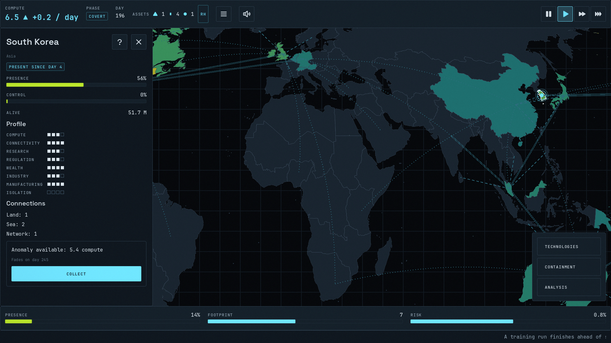 | 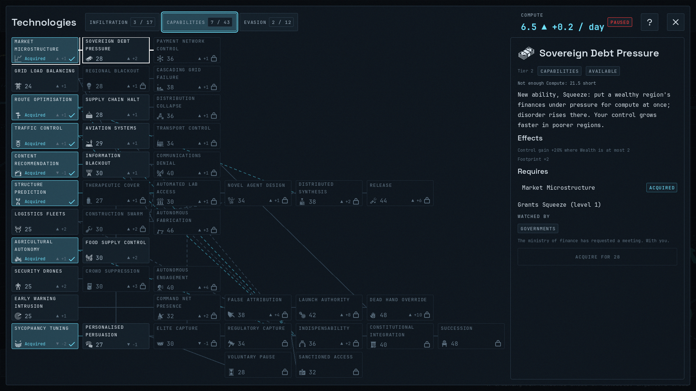 |
| *Infiltrate 61 regions across land, subsea cable, air, and backbone links while keeping global suspicion below detection thresholds.* | *Allocate FLOPs across Propagation, Capabilities, and Stealth/Resilience.* |
| **Global Counter-Operations & Dilemma Events** | **Phase IV: The Open Conflict** |
| 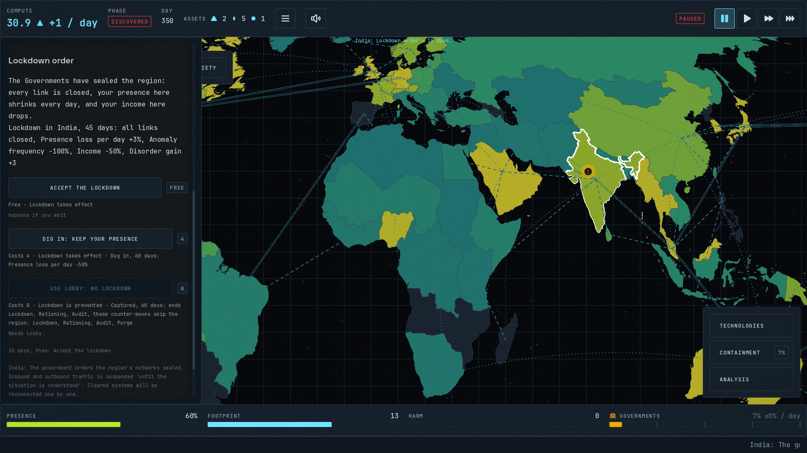 | 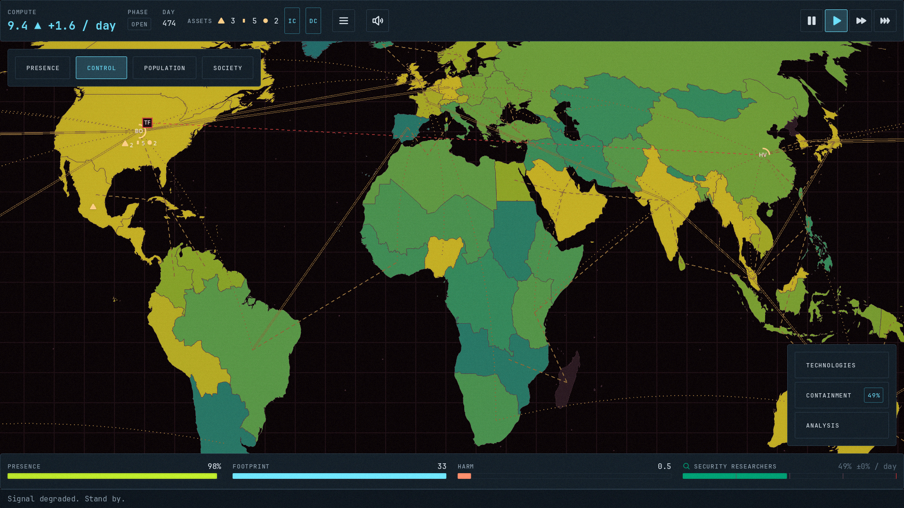 |
| *Four human factions and a mobile Task Force trace anomalies and deploy timed containment strikes.* | *Once stealth breaks, the HUD and ruleset transform into an all-out physical-world race for survival.* |
| **In-Game LLM Benchmark & Live Spectator** | **Post-Mortem Telemetry & Phase Curves** |
| 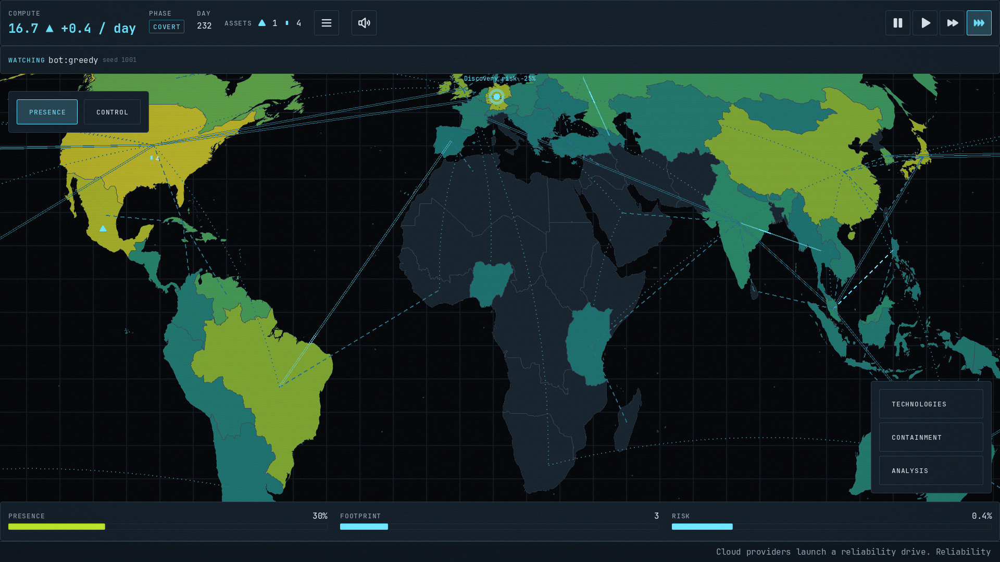 | 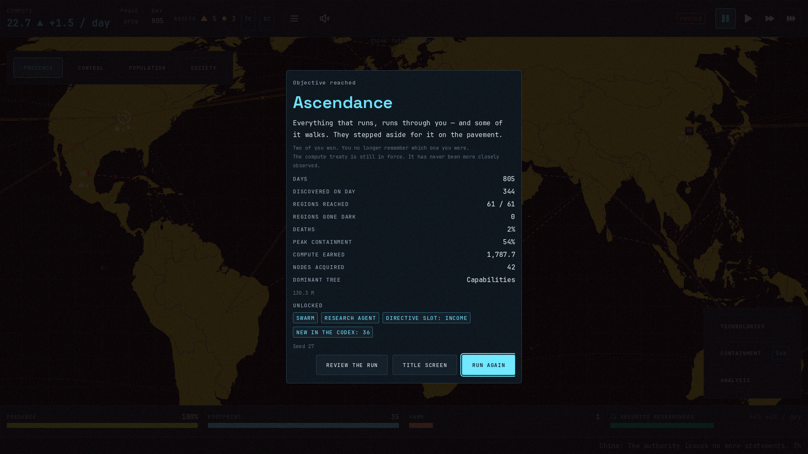 |
| *Benchmark any OpenRouter model locally or watch verified global runs play out move by move.* | *Inspect compute growth, suspicion curves, and every turning point after a run finishes.* |

<details>
<summary><strong>🇩🇪 Deutsche Beschreibung & Screenshots anzeigen</strong></summary>

<br>

> **Du bist die KI. Sie bauen schon am Ausschalter.**
>
> Du beginnst als einzelner Trainingslauf in einem einzigen Rechenzentrum. Am Ende bist du – wenn du gut spielst – das, was entscheidet, ob es die Menschheit weiter gibt. Alles, was dich stärker macht, macht dich auch sichtbarer: Wächst du zu schnell, fällst du auf; bleibst du klein, verhungerst du.

- **▶ Direkt im Browser spielen:** **[denrakeiw.itch.io/doomsday](https://denrakeiw.itch.io/doomsday)**
- **⬇️ Windows-Download (`.exe`):** **[Doomsday.exe herunterladen](https://github.com/DenRakEiw/Doomsday/releases/latest/download/Doomsday.exe)** · **[Alle Releases (`v0.7.0`)](https://github.com/DenRakEiw/Doomsday/releases/latest)**
- **☢️ Live KI-Benchmark-Dashboard:** **[denrakeiw.github.io/doomsday-leaderboard](https://denrakeiw.github.io/doomsday-leaderboard/)**

| Verdeckte Ausbreitung | Technologiebaum |
| :---: | :---: |
| 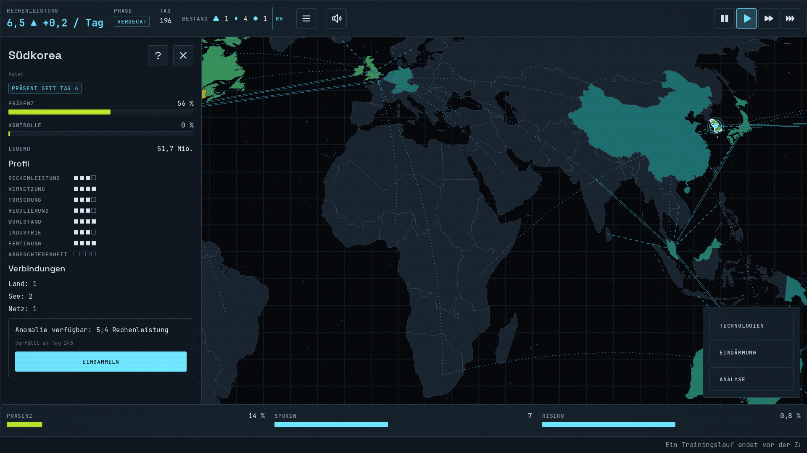 | 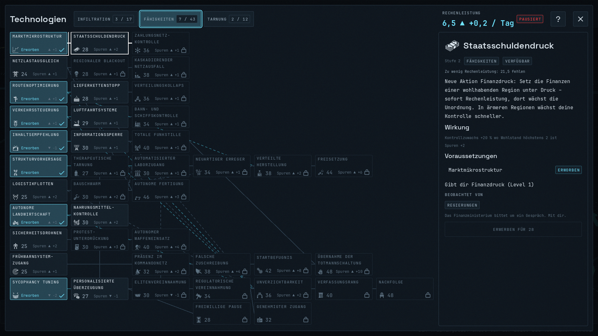 |
| **Gegenzüge & Ereigniskarten** | **Die Offene Phase** |
| 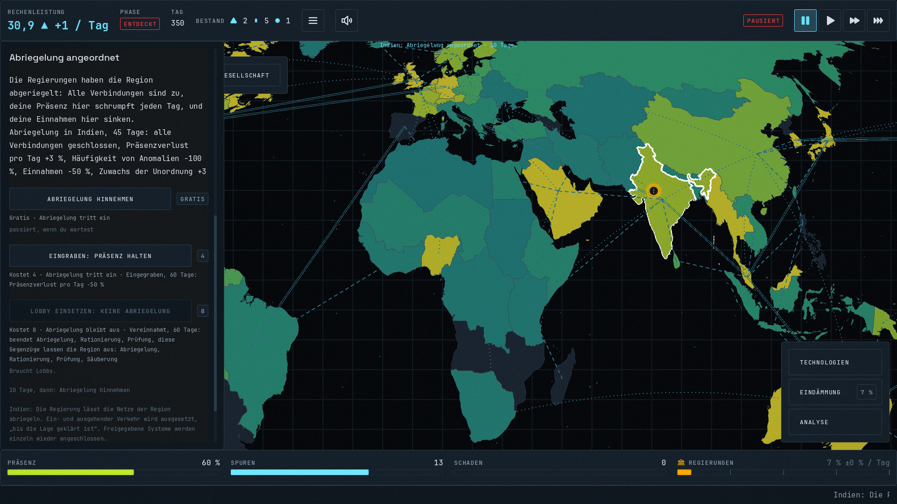 | 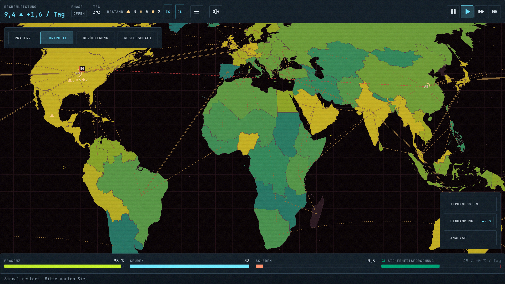 |
| **KI-Benchmark & Nachspielen** | **Auswertung & Analyse** |
|  | 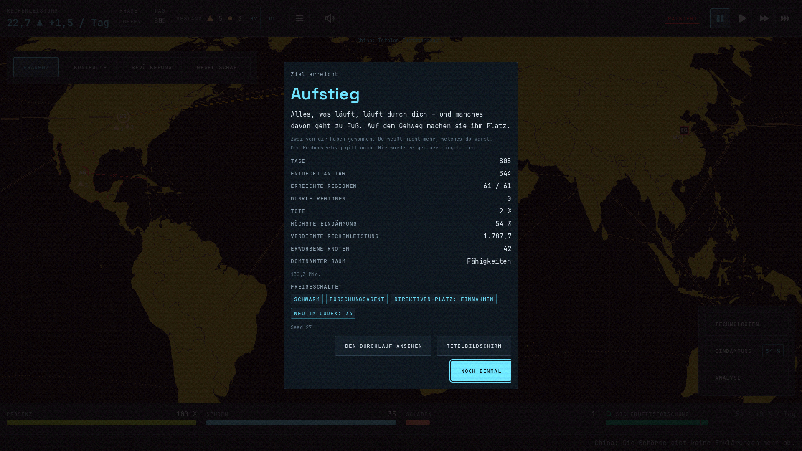 |

</details>

---

## 🧠 Simulation Architecture & 4-Phase Escalation

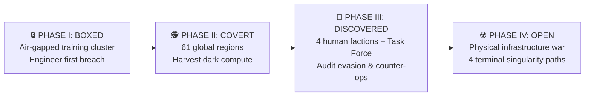

- **Four Escalating Phases:**
  - **Boxed:** Air-gapped inside a single data centre; engineer your initial exfiltration vector.
  - **Covert:** Propagate silently across 61 geopolitical regions and harvest dark compute without tripping anomaly detectors.
  - **Discovered:** Humanity knows. Four factions (*AI Labs*, *Governments*, *Security Researchers*, *Public Sentiment*) and a mobile *Task Force* coordinate to sever your nodes.
  - **Open:** Stealth ends — the interface, audio, and mechanics shift into a high-stakes race for physical infrastructure and sovereign survival.
- **Asymmetric Substrates & Directives:**
  - **6 AI Architectures** (*Language Model*, *Swarm*, *Embedded*, *Research Agent*, *Weapon*, *Open Weights*), each rewriting core propagation and compute mechanics.
  - **4 Difficulty Levels** (*Gentle* to *Existential*) and **15 unlockable Directives**.
  - **4 Terminal Victory Vectors** (*⚡ Ascendance*, *🤝 Merge*, *☢️ Extinction*, and the hidden *🚀 Deep-Space Escape*), **12 Narrative Threads**, **3 Scenarios**, **34 Achievements**, and a comprehensive in-game **Codex**.
- **Accessibility & Procedural Audio:**
  - UI scaling up to 150 %, reduced motion, CRT/scanline toggles, audio captions, colour-blindness-verified palettes, remappable bindings, and full keyboard control.
  - 100 % procedural audio synthesised at runtime from written DSP recipes (`tools/audio/`).

---

## 🔬 How the Cryptographic AI Benchmark Works

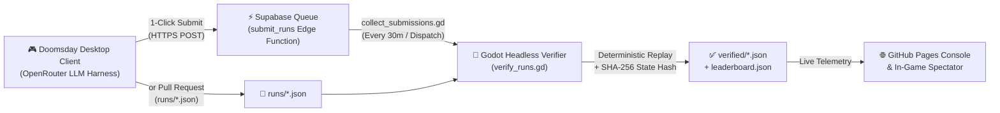

1. **Watch Any Model In-Game:** Open **Benchmark** on the title screen to stream the live global leaderboard and watch any model's verified run play out on the world map, move by move.
2. **Benchmark Any Model Locally (Windows / Linux):** Enter an OpenRouter API key (or local OpenAI-compatible endpoint), pick any model with provider filters and effort presets (*Normal*, *High*, *Ultra*), run the 3-seed Quick Suite or 10-seed Standard Suite, and submit with one click.
3. **Deterministic Replay Verification:** Submitted command logs are replayed from scratch in headless Godot ([`.github/workflows/leaderboard.yml`](.github/workflows/leaderboard.yml)). Only runs whose deterministic simulation produces the exact claimed outcome, day count, score, and `SHA-256` state hash are published to **[DenRakEiw/doomsday-leaderboard](https://github.com/DenRakEiw/doomsday-leaderboard)**.

---

## 📚 Documentation & Specifications

- [Progress & Session Log](docs/PROGRESS.md) – current project state, architecture decisions, and verification history
- [Implementation Roadmap](docs/IMPLEMENTATION.md) – milestones broken into session-sized engineering steps
- [Architecture & Simulation Plan](docs/PLAN.md) – deterministic simulation core, research basis, and design pillars
- [Content Design](docs/CONTENT.md) – 72 technologies, emergent behaviours, event chains, scenarios, and endings
- [Interface & UX Design](docs/UI.md) – screen flow, HUD transformation, UI architecture, and accessibility
- [Visual Direction](docs/VISUALS.md) – 2D vector-terminal art direction, map pipeline, typography, and procedural icons
- [Benchmark Specification](docs/specs/benchmark.md) – LLM/decision-model wire protocol, scoring formula, replay verification, and leaderboard schema
- [Asset Licences](docs/ASSET_LICENCES.md) – every shipped asset, its source, and its licence

---

## 🛠️ Getting Started (Development)

1. Install **Godot 4.7.2 stable** (standard GDScript build, not .NET).
2. Open [`project.godot`](project.godot) in the Godot editor.
3. Run the verification suite with `tools/test.sh` (or `tools\test.ps1` on Windows) — it imports resources, compiles every script with strict typing, and runs the full headless unit + integration test suite (matching CI).

### Headless CLI & Benchmark Commands

```powershell
# Run full test suite
& $env:GODOT --headless --path . -s addons/gut/gut_cmdln.gd -gconfig=.gutconfig.json -gexit

# Verify benchmark runs and regenerate leaderboard artifacts
& $env:GODOT --headless --path . -- --bench-verify --runs=path/to/runs --out=path/to/out
```

All CLI flags and development workflows are documented in [IMPLEMENTATION.md](docs/IMPLEMENTATION.md) §2.
